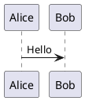

# nimblescape PlantUML

Shows [PlantUML](https://plantuml.com) diagrams in VS Code: in the
```` ```plantuml ```` blocks of Markdown files and in PlantUML files. The
extension carries the PlantUML engine compiled to JavaScript, so it needs no
Java, no Graphviz installation and no server, and it works offline.


## What the extension does on your computer

- **When it works.** The extension starts when a Markdown file or a PlantUML
  file opens, and when VS Code restores a preview of a PlantUML file after a
  restart. It does not run in VS Code for the Web.
- **Rendering.** The diagrams render on your computer, in the preview, with
  the PlantUML engine that the package contains (`@plantuml/core` 1.2026.9,
  PlantUML compiled to JavaScript). The extension uses no PlantUML server,
  starts no Java and no other program, and sends no diagram text and no file
  to the internet. No setting changes this. The security setting of the
  Markdown preview only selects the layout engine: Graphviz with "Disable",
  otherwise Smetana.
- **Markdown preview.** The extension adds a markdown-it plugin, a script and
  a style sheet to the built-in Markdown preview of VS Code. The plugin
  changes only the fenced code blocks with the language `plantuml`.
- **Markdown files.** While the setting `editor.formatOnSave` is on, each save
  of a Markdown file formats the lines of its PlantUML blocks, also when
  another extension, for example Prettier, formats Markdown files. No other
  line changes. An automatic save after a delay does not format, and the
  formatting at save needs `editor.formatOnSaveMode` set to `file`, its
  default. In a PlantUML block, the code completion opens while you type,
  although VS Code turns it off for Markdown files.
- **PlantUML files.** The extension is the default formatter of PlantUML
  files (`"[plantuml]": { "editor.defaultFormatter": "nimblescape.nimblescape-plantuml" }`).
  This default wins over a formatter that you set for all files, but not over
  a formatter that you set for `[plantuml]`. In PlantUML files and in their
  previews, the keys Ctrl+Shift+V and Ctrl+K V (Cmd on macOS) run the preview
  commands of the extension. In Markdown files, these keys stay with the
  Markdown preview of VS Code.
- **Files and data.** For `!include`, `!include_many`, `!include_once` and
  `!includesub`, the extension reads files of the workspace folders and of
  the folder of the document only, up to 1 MB each, and watches them for
  changes. It reads no address of the internet. It writes no file, except the
  formatting of the file that you format or save. The previews keep the
  pictures of the 50 most recently rendered diagrams, with their text, in the
  storage that VS Code keeps for its previews on your computer.
- **Network.** The extension connects to no address and collects no
  telemetry.
- **Restricted Mode and virtual workspaces.** The extension works with all
  features in Restricted Mode and in virtual workspaces, because it only reads
  the files of the workspace and runs no program of the workspace.

[Security](https://github.com/nimblescape/nimblescape-plantuml/blob/main/docs/security.md#what-the-extension-does-on-your-computer)
describes each step and where its protection ends.

## Features

- **Markdown preview.** The built-in Markdown preview shows each
  ```` ```plantuml ```` block as a diagram, also in the rendered Git diff of a
  Markdown file. Outside the PlantUML blocks, Markdown works as without the
  extension.
- **Preview of PlantUML files.** A PlantUML file shows as a preview in the
  same tab or to the side, as a Markdown file does. The Git diff of a
  PlantUML file shows as a rendered diff, with marks on the changed diagrams.
- **Editing.** Syntax highlighting, code completion of keywords and declared
  names, and formatting, in PlantUML files and in the PlantUML blocks of
  Markdown files. The members of a class have the colors of code, by the
  notation of UML (for example `name : Type` or
  `name(param : Type) : Type`). Folding and indentation while typing in
  PlantUML files.
- **UML notation.** UML diagrams show the notation of the UML standard, as
  far as PlantUML allows; a setting switches to the own notation of
  PlantUML.
- **Included files.** `!include` and `!includesub` read files of your
  workspace. The package contains the library C4 of the standard library of
  PlantUML.
- **Diagram types.** Every diagram type that the engine renders, for example
  sequence, use case, class, activity, component, state and timing diagrams,
  Gantt charts, mind maps, and JSON and YAML data, with the themes, emoji and
  icons of PlantUML, for light and dark color themes.

The extension shows diagrams only; it does not export them to image files.

## Usage

In a Markdown file, write a fenced code block with the language `plantuml`:

````markdown

````

Then open the preview:

| Command | Keys | Effect |
| --- | --- | --- |
| Markdown: Open Preview to the Side | Ctrl+K V | Opens the preview of a Markdown file next to its text. |
| PlantUML: Open Preview to the Side | Ctrl+K V | Opens the preview of a PlantUML file next to its text. |
| Markdown: Toggle Preview, PlantUML: Toggle Preview | Ctrl+Shift+V | Switches the tab between the text and the preview. In the diff of a PlantUML file, it switches between the diff and the rendered diff. |
| Format Document | Shift+Alt+F (Linux: Ctrl+Shift+I) | Formats a PlantUML file, or the PlantUML blocks of a Markdown file. |
| PlantUML: Format PlantUML Blocks | | Formats the PlantUML blocks of a Markdown file when another extension formats Markdown files. |

On macOS, use Cmd instead of Ctrl, and Shift+Option+F for Format Document.
The [user guide](https://github.com/nimblescape/nimblescape-plantuml/blob/main/docs/guide.md)
describes every feature.

## Files

| Files | Language |
| --- | --- |
| `.puml`, `.plantuml`, `.pu`, `.iuml` and `.wsd` | PlantUML, with the line comment `'` and the block comment `/' '/` |

## Settings

| Setting | Default | Effect |
| --- | --- | --- |
| `nimblescape.plantuml.umlNotation` | `true` | Renders UML diagrams in the notation of the UML standard, as far as PlantUML allows: a keyword such as «interface» above the name of a class instead of a colored circle, the characters `-`, `#`, `~` and `+` for the visibility of attributes and methods, underlined static members, and the UML style of PlantUML for sequence and object diagrams. The value `false` shows the own notation of PlantUML. |

## Limits

- The Markdown preview allows no WebAssembly, so PlantUML arranges the
  diagrams there with its own layout engine Smetana instead of Graphviz,
  unless you set the preview security to "Disable". Class, component and
  state diagrams can then look a little different.
- The engine does not render `ditaa`, `dot`, `math`, `latex`, `chen`, `board`,
  `git`, `wire`, `files`, `hcl` and `chronology`, and renders a wireframe only
  with `@startsalt`, not inside `@startuml`.
  It shows the first page of a diagram with `newpage` only, makes no
  clickable links and shows no images (``).
- Included files must be in a workspace folder or in the folder of the
  document, with up to 1 MB each, and the previews use their saved text. The
  extension reads no file from the internet, and of the standard library of
  PlantUML it contains the library C4 only.
- The rendered diff of a PlantUML file marks the changed diagrams, not the
  changed elements in a diagram.
- The extension
  [PlantUML by jebbs](https://marketplace.visualstudio.com/items?itemName=jebbs.plantuml)
  (vscode-plantuml) also contributes the language PlantUML and a Markdown
  preview of PlantUML blocks. With both extensions installed, it is not
  defined which one renders and highlights a diagram. Use one of the two.

## About PlantUML

nimblescape PlantUML is not a product of the PlantUML project, and the
PlantUML project does not endorse it. It renders with the npm package
[`@plantuml/core`](https://www.npmjs.com/package/@plantuml/core), the
official JavaScript build of PlantUML by Arnaud Roques under the MIT License.
The emoji graphics come from [Twemoji](https://github.com/twitter/twemoji)
(CC BY 4.0). The
[third-party notices](https://github.com/nimblescape/nimblescape-plantuml/blob/main/THIRD-PARTY-NOTICES.md)
list every bundled component and its license.

---

[Change log](https://github.com/nimblescape/nimblescape-plantuml/blob/main/CHANGELOG.md) · [Contributing](https://github.com/nimblescape/nimblescape-plantuml/blob/main/CONTRIBUTING.md) · [User guide](https://github.com/nimblescape/nimblescape-plantuml/blob/main/docs/guide.md) · [Support](https://github.com/nimblescape/nimblescape-plantuml/blob/main/SUPPORT.md) · [Issues](https://github.com/nimblescape/nimblescape-plantuml/issues) · [Source](https://github.com/nimblescape/nimblescape-plantuml)

© 2026 Hannes Stauss (scalarion@nimblescape.com) · [MIT License](https://github.com/nimblescape/nimblescape-plantuml/blob/main/LICENSE).
