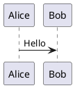

<!--
SPDX-License-Identifier: MIT
© 2026 Hannes Stauss (scalarion@nimblescape.com)
Licensed under the MIT License. See LICENSE in the repository root for details.
-->

# User guide

This guide describes the features of nimblescape PlantUML and how to use them.
The extension shows [PlantUML](https://plantuml.com) diagrams in two places:
in the PlantUML blocks of Markdown files, and in PlantUML files. Markdown
files come first; PlantUML files have the same features.

The extension is in development. The table shows the state of each feature,
and [requirements.md](requirements.md) defines each feature exactly; the ID
in the last column links to its definition. The key combinations are those of
Windows and Linux; on macOS, use Cmd instead of Ctrl.

| Feature | Markdown files | PlantUML files | State | Requirements |
| --- | --- | --- | --- | --- |
| [Language PlantUML](#plantuml-files) | | yes | available | [R-PUML-001](requirements.md#r-puml-001) |
| [Diagrams in the preview](#diagrams-in-the-markdown-preview) | yes | yes | planned | [R-MD-001](requirements.md#r-md-001), [R-PUML-002](requirements.md#r-puml-002), [R-PUML-003](requirements.md#r-puml-003) |
| [Switch between text and preview in one tab](#switch-between-text-and-preview) | yes | yes | planned | [R-MD-001](requirements.md#r-md-001), [R-PUML-002](requirements.md#r-puml-002) |
| [Rendered Git diff](#rendered-git-diff) | yes, with marks on the changes | yes, side by side | planned | [R-MD-002](requirements.md#r-md-002), [R-PUML-004](requirements.md#r-puml-004) |
| [Syntax highlighting](#syntax-highlighting) | yes | yes | planned | [R-MD-003](requirements.md#r-md-003), [R-PUML-005](requirements.md#r-puml-005) |
| [Code completion](#code-completion) | yes | yes | planned | [R-MD-004](requirements.md#r-md-004), [R-PUML-006](requirements.md#r-puml-006) |
| [Formatting](#formatting) | yes | yes | planned | [R-MD-005](requirements.md#r-md-005), [R-PUML-007](requirements.md#r-puml-007) |

## How the extension renders

The extension contains the PlantUML engine: PlantUML compiled to JavaScript,
from the npm package
[`@plantuml/core`](https://www.npmjs.com/package/@plantuml/core). The engine
runs inside VS Code. You need no Java, no Graphviz installation and no
PlantUML server, and the extension sends no diagram text to the internet. The
extension renders every diagram type that this engine renders: for example
sequence, use case, class, activity, component, state and timing diagrams,
and also Gantt charts, mind maps, JSON and YAML data, and wireframes. The
themes of PlantUML (`!theme`), the emoji and the Open Iconic icons are part of
the engine and work offline.

The engine does not contain the standard library of PlantUML, for example
`!include <C4/C4_Context>` or the AWS and Azure icons. How the extension
handles these includes is decided in step 2 of the plan.

The extension only shows diagrams. It does not export a diagram to a file, in
no format.

## Markdown files

### Diagrams in the Markdown preview

Write a diagram in a fenced code block with the language `plantuml`:

````markdown

````

The built-in Markdown preview of VS Code shows the block as a diagram. Open
the preview with one of these commands:

| Command | Keys | Effect |
| --- | --- | --- |
| Markdown: Open Preview to the Side | Ctrl+K V | Opens the preview next to the text. The preview follows every change while you type. |
| Markdown: Toggle Preview | Ctrl+Shift+V | Switches the tab between the text and the preview. |

The extension adds the diagrams to the preview of VS Code; it does not
replace the preview. All other settings of the Markdown preview stay valid.

### Switch between text and preview

Ctrl+Shift+V switches the same tab between the text of the Markdown file and
its preview, in both directions. The title bar of the text editor has the
button "Open as Preview", and the title bar of the preview has the button
"Reopen as source file". VS Code provides these commands; the extension adds
the diagrams.

### Rendered Git diff

VS Code can show the diff of a Markdown file as rendered text:

1. Open the diff of the file, for example from the view "Source Control".
2. Run "View: Reopen Editor With…" from the command palette, and choose "Markdown Preview".

The diff then shows the old and the new version as rendered Markdown, with
marks on the blocks that changed. The PlantUML blocks of both versions show as
diagrams. The setting `diffEditor.renderSideBySide` selects whether both
versions show next to each other or in one column.

To open every Markdown diff in this way, add the preview to the setting
`workbench.diffEditorAssociations`.

## PlantUML files

Files with the extensions `.puml`, `.plantuml`, `.pu`, `.iuml` and `.wsd` have
the language PlantUML. "Toggle Line Comment" (Ctrl+/) uses the PlantUML line
comment `'`, and "Toggle Block Comment" uses the block comment
`/' '/`. A file can hold several diagrams, each from `@startuml` (or another
`@start…` line) to its `@end…` line.

### Preview and switching

PlantUML files work like Markdown files:

| Command | Keys | Effect |
| --- | --- | --- |
| PlantUML: Open Preview to the Side | Ctrl+K V | Opens the preview next to the text. The preview follows every change while you type. |
| PlantUML: Toggle Preview | Ctrl+Shift+V | Switches the tab between the text and the preview, in both directions. |
| PlantUML: Open as Preview | button in the title bar of the text editor | Shows the preview in the same tab. |
| PlantUML: Reopen as Source | button in the title bar of the preview | Shows the text in the same tab. |

### Rendered Git diff of PlantUML files

1. Open the diff of the file, for example from the view "Source Control".
2. Run "View: Reopen Editor With…" from the command palette, and choose "PlantUML Preview".

The diff then shows the old diagram and the new diagram next to each other.
It has no marks on the changes: VS Code offers the marks only through an API
that is still in test (`customEditorDiffs`), and extensions in the Marketplace
cannot use such an API. The extension adds the marks when VS Code makes the
API final.

## Editing

The following features work in PlantUML files and in the PlantUML blocks of
Markdown files.

### Syntax highlighting

Keywords, arrows, strings, comments and the `@start…` and `@end…` lines of
the diagram have their own colors, from the color theme of VS Code.

### Code completion

While you type, the editor proposes PlantUML keywords and names, for example
diagram types after `@start`, and keywords such as `participant`, `class` or
`skinparam`. Ctrl+Space shows the proposals at any time.

### Formatting

The commands "Format Document" and "Format Selection" indent
the blocks of a PlantUML file, for example the content of `package { … }` or
`if … endif`. In a Markdown file, the formatting changes only the text of the
PlantUML blocks and no other text of the file.

---

© 2026 Hannes Stauss (scalarion@nimblescape.com) ·
[MIT License](https://github.com/nimblescape/nimblescape-plantuml/blob/main/LICENSE).
