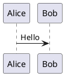

<!--
SPDX-License-Identifier: MIT
© 2026 Hannes Stauss (scalarion@nimblescape.com)
Licensed under the MIT License. See LICENSE in the repository root for details.
-->

# User guide

This guide describes the features of nimblescape PlantUML and how to use them.
The extension shows [PlantUML](https://plantuml.com) diagrams in two places:
in the PlantUML blocks of Markdown files, and in PlantUML files. Markdown
files come first; PlantUML files have the same features.

The extension is in development. The table shows the state of each feature,
and [requirements.md](requirements.md) defines each feature exactly; the ID
in the last column links to its definition. The key combinations are those of
Windows and Linux; on macOS, use Cmd instead of Ctrl.

| Feature | Markdown files | PlantUML files | State | Requirements |
| --- | --- | --- | --- | --- |
| [Language PlantUML](#plantuml-files) | | yes | available | [R-PUML-001](requirements.md#r-puml-001) |
| [Diagrams in the preview](#diagrams-in-the-markdown-preview) | yes | yes | Markdown: in development; PlantUML files: planned | [R-MD-001](requirements.md#r-md-001), [R-PUML-002](requirements.md#r-puml-002), [R-PUML-003](requirements.md#r-puml-003) |
| [Switch between text and preview in one tab](#switch-between-text-and-preview) | yes | yes | Markdown: in development; PlantUML files: planned | [R-MD-001](requirements.md#r-md-001), [R-PUML-002](requirements.md#r-puml-002) |
| [Rendered Git diff](#rendered-git-diff) | yes, with marks on the changes | yes, side by side | Markdown: in development; PlantUML files: planned | [R-MD-002](requirements.md#r-md-002), [R-PUML-004](requirements.md#r-puml-004) |
| [Syntax highlighting](#syntax-highlighting) | yes | yes | in development | [R-MD-003](requirements.md#r-md-003), [R-PUML-005](requirements.md#r-puml-005) |
| [Code completion](#code-completion) | yes | yes | in development | [R-MD-004](requirements.md#r-md-004), [R-PUML-006](requirements.md#r-puml-006) |
| [Formatting](#formatting) | yes | yes | planned | [R-MD-005](requirements.md#r-md-005), [R-PUML-007](requirements.md#r-puml-007) |
| [No change outside PlantUML blocks](#diagrams-in-the-markdown-preview) | yes | | in development | [R-MD-006](requirements.md#r-md-006) |
| [UML notation in class diagrams](#uml-notation-in-class-diagrams) | yes | yes | Markdown: in development; PlantUML files: planned | [R-GEN-007](requirements.md#r-gen-007) |

## How the extension renders

The extension contains the PlantUML engine: PlantUML compiled to JavaScript,
from the npm package
[`@plantuml/core`](https://www.npmjs.com/package/@plantuml/core). The engine
runs inside VS Code. You need no Java, no Graphviz installation and no
PlantUML server, and the extension sends no diagram text to the internet. The
extension renders every diagram type that this engine renders: for example
sequence, use case, class, activity, component, state and timing diagrams,
and also Gantt charts, mind maps, JSON and YAML data, and wireframes. The
themes of PlantUML (`!theme`), the emoji and the Open Iconic icons are part of
the engine and work offline.

The engine does not contain the standard library of PlantUML, for example
`!include <C4/C4_Context>` or the AWS and Azure icons. How the extension
handles these includes is decided in step 2 of the plan.

The extension only shows diagrams. It does not export a diagram to a file, in
no format.

## Markdown files

### Diagrams in the Markdown preview

Write a diagram in a fenced code block with the language `plantuml`:

````markdown

````

The built-in Markdown preview of VS Code shows the block as a diagram. Open
the preview with one of these commands:

| Command | Keys | Effect |
| --- | --- | --- |
| Markdown: Open Preview to the Side | Ctrl+K V | Opens the preview next to the text. The preview follows every change while you type. |
| Markdown: Toggle Preview | Ctrl+Shift+V | Switches the tab between the text and the preview. |

The extension adds the diagrams to the preview of VS Code; it does not
replace the preview. The diagrams follow the color theme: with a dark theme,
PlantUML draws them for a dark background. Outside the PlantUML blocks, the Markdown editor and the
Markdown preview work as without the extension, and all settings of the
Markdown preview stay valid.

#### Layout of diagrams in the Markdown preview

The security policy of the Markdown preview does not allow WebAssembly. The
Graphviz layout of the engine needs WebAssembly, so in the preview PlantUML
arranges the diagrams with its own layout engine, Smetana. Most diagrams look
the same; the arrangement of class, component and state diagrams can differ a
little from the arrangement of Graphviz. When you set the preview security to
"Disable" ("Markdown: Change Preview Security Settings"), the preview allows
WebAssembly and the extension uses Graphviz. Only do this for documents that
you trust.

### Switch between text and preview

Ctrl+Shift+V switches the same tab between the text of the Markdown file and
its preview, in both directions. The title bar of the text editor has the
button "Open as Preview", and the title bar of the preview has the button
"Reopen as source file". VS Code provides these commands; the extension adds
the diagrams.

### Rendered Git diff

VS Code can show the diff of a Markdown file as rendered text:

1. Open the diff of the file, for example from the view "Source Control".
2. Run "View: Reopen Editor With…" from the command palette, and choose "Markdown Preview".

The diff then shows the old and the new version as rendered Markdown, with
marks on the blocks that changed. The PlantUML blocks of both versions show as
diagrams. A PlantUML block that changed gets the same mark as any other block:
a colored background for an added or a deleted block, and a bar on the left
for a changed block. The mark covers the whole diagram; the diff does not mark
single elements of a diagram. The setting `diffEditor.renderSideBySide`
selects whether both versions show next to each other or in one column.

To open every Markdown diff in this way, add the preview to the setting
`workbench.diffEditorAssociations`.

## PlantUML files

Files with the extensions `.puml`, `.plantuml`, `.pu`, `.iuml` and `.wsd` have
the language PlantUML. "Toggle Line Comment" (Ctrl+/) uses the PlantUML line
comment `'`, and "Toggle Block Comment" uses the block comment
`/' '/`. A file can hold several diagrams, each from `@startuml` (or another
`@start…` line) to its `@end…` line.

### Preview and switching

PlantUML files work like Markdown files:

| Command | Keys | Effect |
| --- | --- | --- |
| PlantUML: Open Preview to the Side | Ctrl+K V | Opens the preview next to the text. The preview follows every change while you type. |
| PlantUML: Toggle Preview | Ctrl+Shift+V | Switches the tab between the text and the preview, in both directions. |
| PlantUML: Open as Preview | button in the title bar of the text editor | Shows the preview in the same tab. |
| PlantUML: Reopen as Source | button in the title bar of the preview | Shows the text in the same tab. |

### Rendered Git diff of PlantUML files

1. Open the diff of the file, for example from the view "Source Control".
2. Run "View: Reopen Editor With…" from the command palette, and choose "PlantUML Preview".

The diff then shows the old diagram and the new diagram next to each other.
It has no marks on the changes: VS Code offers the marks only through an API
that is still in test (`customEditorDiffs`), and extensions in the Marketplace
cannot use such an API. The extension adds the marks when VS Code makes the
API final.

## Editing

The following features work in PlantUML files and in the PlantUML blocks of
Markdown files.

### Syntax highlighting

Keywords, arrows, strings, comments and the `@start…` and `@end…` lines of
the diagram have their own colors, from the color theme of VS Code. In
detail, the highlighting colors:

- the `@start…` and `@end…` lines;
- comments: a line that starts with `'`, and a comment between `/'` and `'/`;
- the directives of the preprocessor, for example `!include` or `!theme`, and
  variables such as `$name`;
- the keywords that declare an element, for example `participant`, `class`
  or `component`, and the name that follows;
- the keywords of statements, for example `if`, `else`, `alt`, `loop`,
  `note`, `title` or `skinparam`;
- strings in double quotes, stereotypes such as `<<Entity>>`, colors such as
  `#pink`, the visibility of members, and modifiers such as `{static}`;
- arrows, for example `->`, `-->`, `<|--`, `..>` or `-[#red]->`.

The text of a note, a legend or a title of several lines keeps the color of
plain text. In a Markdown file, only the text inside a PlantUML block gets
these colors; the rest of the file keeps the colors of Markdown. Inside a
PlantUML block, the command "Toggle Line Comment" (Ctrl+/) uses the comment
of PlantUML (`'`).

### Code completion

While you type, the editor proposes PlantUML keywords and the names that the
diagram declares. Ctrl+Space shows the proposals at any time. The proposals
depend on the place of the cursor:

| Place | Proposals |
| --- | --- |
| Start of a line, after `@` | The `@start…` and `@end…` lines of the diagram types, for example `@startuml` or `@endmindmap`. |
| Start of a line, after `!` | The directives of the preprocessor, for example `!include`, `!theme` or `!procedure`. |
| Start of a line | The keywords that start a statement, for example `participant`, `class`, `if`, `note` or `skinparam`, and the declared names. |
| After `abstract` | The keyword `class`. |
| Later in a line | The declared names, and the keywords that connect the parts of a statement, for example `as`, `extends` or `of`. |

The declared names come from the same PlantUML file, or in a Markdown file
from the same PlantUML block; other blocks of the file do not count. A name is
declared:

- by a keyword, for example `class Car`, `participant Alice` or
  `component [Web server] as Web`. With an alias, the proposal is the alias,
  because the other lines of the diagram use it;
- by a link, for example both names in `Alice -> Bob` or in
  `[Web] ..> [Database]`;
- by a component, a use case, an actor or a task at the start of a line, for
  example `[Web server]`, `(Log in)`, `:User:` or `[Design] lasts 5 days`;
- by the preprocessor, for example `!procedure $box($name)`,
  `!$color = "red"` or `!define LIGHT`.

A quoted name, a component or a use case can be completed from its opening
character: after `"Lo`, `[We` or `(Lo`, the proposals replace the text from
the `"`, `[` or `(` on.

The editor proposes nothing in places where you write free text or a new
name: in comments, in the text of a note, a legend or a title of several
lines, in the label after the `:` of a link, in an action of an activity
diagram (`:text;`), in a `skinparam` line, in the path of an `!include`, and
after a keyword that declares a new element, for example after `class `.

In a Markdown file, the editor of VS Code does not show proposals while you
type. Inside a PlantUML block, the extension shows them while you type, as in
a PlantUML file. The setting `editor.quickSuggestions` of the language
`plantuml` controls this in both places, for example
`"[plantuml]": { "editor.quickSuggestions": { "other": "off" } }` turns it
off. Outside the PlantUML blocks, the Markdown editor works as without the
extension.

### Formatting

The commands "Format Document" and "Format Selection" indent
the blocks of a PlantUML file, for example the content of `package { … }` or
`if … endif`. In a Markdown file, the formatting changes only the text of the
PlantUML blocks and no other text of the file.

## Settings

| Setting | Default | Effect |
| --- | --- | --- |
| `nimblescape.plantuml.classIcons` | `true` | `true` shows the colored icons of PlantUML in class diagrams. `false` shows the UML notation. |

The settings apply to the PlantUML blocks of Markdown files and to PlantUML
files. You can set them for the user, for a workspace or for a folder of a
workspace. An open preview renders again when a setting changes.

### UML notation in class diagrams

PlantUML draws the kind of a class as a colored circle with a letter, and the
visibility of an attribute or a method as a colored icon. With
`nimblescape.plantuml.classIcons` set to `false`, class diagrams show the
notation of the UML standard instead.

The visibility shows as a character:

| Visibility | Character |
| --- | --- |
| private | `-` |
| protected | `#` |
| package private | `~` |
| public | `+` |

The kind of a class shows as a keyword above its name:

| Declaration | Display |
| --- | --- |
| `class` | the name only |
| `abstract class` | the name in italics |
| `interface` | «interface» |
| `enum` | «enumeration» |
| `annotation` | «annotation» |
| `protocol`, `struct`, `exception`, `record`, `dataclass` | «protocol», «struct», «exception», «record», «dataclass» |
| `metaclass`, `stereotype` | «metaclass», «stereotype» |

An abstract attribute or method (`{abstract}`) shows in italics, and a static
one (`{static}` or `{classifier}`) is underlined, as the UML standard
defines. PlantUML draws them so with and without the setting.

How the extension does this, and the limits:

- It adds the lines `skinparam classAttributeIconSize 0` and `hide circle`
  after the `@startuml` line of each diagram. A diagram that sets
  `skinparam classAttributeIconSize`, `hide circle` or `show circle` itself
  keeps its own value, because its own line comes later.
- It adds the keyword as a stereotype to the declaration of the class, for
  example `interface Shape <<interface>>`. A declaration that has this
  stereotype already stays as it is.
- It adds no keyword in a component, deployment or use case diagram. There,
  `interface` declares the circle of a provided interface, which is UML
  notation already.
- A declaration with nested generic parameters, for example
  `interface Map<K, List<V>>`, gets no keyword, because PlantUML does not
  accept a stereotype after them. An `entity` gets no keyword, because the
  same declaration is a participant in a sequence diagram.
- Diagrams of other types, for example `@startmindmap` or `@startgantt`, stay
  as they are.
- When a diagram has an error, the error picture of PlantUML can show the
  added lines.

---

© 2026 Hannes Stauss (scalarion@nimblescape.com) ·
[MIT License](https://github.com/nimblescape/nimblescape-plantuml/blob/main/LICENSE).
