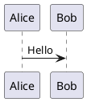

<!--
SPDX-License-Identifier: MIT
© 2026 Hannes Stauss (scalarion@nimblescape.com)
Licensed under the MIT License. See LICENSE in the repository root for details.
-->

# User guide

This guide describes the features of nimblescape PlantUML and how to use them.
The extension shows [PlantUML](https://plantuml.com) diagrams in two places:
in the PlantUML blocks of Markdown files, and in PlantUML files. Markdown
files come first; PlantUML files have the same features.

The extension is in development. The table shows the state of each feature,
and [requirements.md](requirements.md) defines each feature exactly; the ID
in the last column links to its definition. The key combinations are those of
Windows and Linux; on macOS, use Cmd instead of Ctrl.

| Feature | Markdown files | PlantUML files | State | Requirements |
| --- | --- | --- | --- | --- |
| [Language PlantUML](#plantuml-files) | | yes | available | [R-PUML-001](requirements.md#r-puml-001) |
| [Diagrams in the preview](#diagrams-in-the-markdown-preview) | yes | yes | in development | [R-MD-001](requirements.md#r-md-001), [R-PUML-002](requirements.md#r-puml-002), [R-PUML-003](requirements.md#r-puml-003) |
| [Switch between text and preview in one tab](#switch-between-text-and-preview) | yes | yes | in development | [R-MD-001](requirements.md#r-md-001), [R-PUML-002](requirements.md#r-puml-002) |
| [Rendered Git diff](#rendered-git-diff) | yes, with marks on the changes | yes, side by side, with marks on the changed diagrams | in development | [R-MD-002](requirements.md#r-md-002), [R-PUML-004](requirements.md#r-puml-004) |
| [Syntax highlighting](#syntax-highlighting) | yes | yes | in development | [R-MD-003](requirements.md#r-md-003), [R-PUML-005](requirements.md#r-puml-005) |
| [Code completion](#code-completion) | yes | yes | in development | [R-MD-004](requirements.md#r-md-004), [R-PUML-006](requirements.md#r-puml-006) |
| [Formatting](#formatting) | yes | yes | in development | [R-MD-005](requirements.md#r-md-005), [R-PUML-007](requirements.md#r-puml-007) |
| [No change outside PlantUML blocks](#diagrams-in-the-markdown-preview) | yes | | in development | [R-MD-006](requirements.md#r-md-006) |
| [UML notation](#uml-notation) | yes | yes | in development | [R-GEN-007](requirements.md#r-gen-007) |

## How the extension renders

The extension contains the PlantUML engine: PlantUML compiled to JavaScript,
from the npm package
[`@plantuml/core`](https://www.npmjs.com/package/@plantuml/core). The engine
runs inside VS Code. You need no Java, no Graphviz installation and no
PlantUML server, and the extension sends no diagram text to the internet. The
extension renders every diagram type that this engine renders: for example
sequence, use case, class, activity, component, state and timing diagrams,
and also Gantt charts, mind maps, JSON and YAML data, and wireframes. The
themes of PlantUML (`!theme`), the emoji and the Open Iconic icons are part of
the engine and work offline.

The engine does not contain the standard library of PlantUML, for example
`!include <C4/C4_Context>` or the AWS and Azure icons. How the extension
handles these includes is decided in step 2 of the plan.

The extension only shows diagrams. It does not export a diagram to a file, in
no format.

The engine needs a moment to start when a preview opens. While a diagram
renders, the preview shows the note "Rendering the diagram…", or the last
diagram of the block while you change its text; it never shows the diagram
text in its place. The previews keep the pictures of the 50 most recently
rendered diagrams in the storage that VS Code keeps for its previews on your
computer. A preview that opens again shows these diagrams at once, also after
a restart of VS Code.

## Markdown files

### Diagrams in the Markdown preview

Write a diagram in a fenced code block with the language `plantuml`:

````markdown

````

The built-in Markdown preview of VS Code shows the block as a diagram. Open
the preview with one of these commands:

| Command | Keys | Effect |
| --- | --- | --- |
| Markdown: Open Preview to the Side | Ctrl+K V | Opens the preview next to the text. The preview follows every change while you type. |
| Markdown: Toggle Preview | Ctrl+Shift+V | Switches the tab between the text and the preview. |

The extension adds the diagrams to the preview of VS Code; it does not
replace the preview. The diagrams follow the color theme: with a dark theme,
PlantUML draws them for a dark background. Outside the PlantUML blocks, the Markdown editor and the
Markdown preview work as without the extension, and all settings of the
Markdown preview stay valid.

#### Layout of diagrams in the Markdown preview

The security policy of the Markdown preview does not allow WebAssembly. The
Graphviz layout of the engine needs WebAssembly, so in the preview PlantUML
arranges the diagrams with its own layout engine, Smetana. Most diagrams look
the same; the arrangement of class, component and state diagrams can differ a
little from the arrangement of Graphviz. When you set the preview security to
"Disable" ("Markdown: Change Preview Security Settings"), the preview allows
WebAssembly and the extension uses Graphviz. Only do this for documents that
you trust.

### Switch between text and preview

Ctrl+Shift+V switches the same tab between the text of the Markdown file and
its preview, in both directions. The title bar of the text editor has the
button "Open as Preview", and the title bar of the preview has the button
"Reopen as source file". VS Code provides these commands; the extension adds
the diagrams.

### Rendered Git diff

VS Code can show the diff of a Markdown file as rendered text:

1. Open the diff of the file, for example from the view "Source Control".
2. Run "View: Reopen Editor With…" from the command palette, and choose "Markdown Preview".

The diff then shows the old and the new version as rendered Markdown, with
marks on the blocks that changed. The PlantUML blocks of both versions show as
diagrams. A PlantUML block that changed gets the same mark as any other block:
a colored background for an added or a deleted block, and a bar on the left
for a changed block. The mark covers the whole diagram; the diff does not mark
single elements of a diagram. The setting `diffEditor.renderSideBySide`
selects whether both versions show next to each other or in one column.

To open every Markdown diff in this way, add the preview to the setting
`workbench.diffEditorAssociations`.

## PlantUML files

Files with the extensions `.puml`, `.plantuml`, `.pu`, `.iuml` and `.wsd` have
the language PlantUML. "Toggle Line Comment" (Ctrl+/) uses the PlantUML line
comment `'`, and "Toggle Block Comment" uses the block comment
`/' '/`. A file can hold several diagrams, each from `@startuml` (or another
`@start…` line) to its `@end…` line.

### Preview and switching

PlantUML files work like Markdown files:

| Command | Keys | Effect |
| --- | --- | --- |
| PlantUML: Open Preview to the Side | Ctrl+K V | Opens the preview next to the text. The preview follows every change while you type. |
| PlantUML: Toggle Preview | Ctrl+Shift+V | Switches the tab between the text and the preview, in both directions. In a diff, it switches between the diff and the rendered diff. |
| PlantUML: Open as Preview | button in the title bar of the text editor or of the diff | Shows the preview or the rendered diff in the same tab. |
| PlantUML: Reopen as Source | button in the title bar of the preview or of the rendered diff | Shows the text or the diff in the same tab. |

### Rendered Git diff of PlantUML files

1. Open the diff of the file, for example from the view "Source Control".
2. Press Ctrl+Shift+V, or click the button "Open as Preview" in the title bar.

The tab then shows the rendered diff: the old diagrams on the left and the new
diagrams on the right. Equal diagrams stand next to each other, and a changed
diagram stands next to its old version. A bar in the colors of the change
marks of the editor marks each change:

| Bar | Meaning |
| --- | --- |
| On both sides, in the color of changed lines | The diagram changed. |
| On the right side, in the color of added lines | The diagram is new. |
| On the left side, in the color of deleted lines | The diagram was removed. |

The rendered diff follows your changes while you type. Ctrl+Shift+V or the
button "Reopen as Source" switches back to the diff.

Limits:

- The marks show which diagrams changed, not which elements in a diagram
  changed. VS Code offers marks on single lines only through an API that is
  still in test (`customEditorDiffs`), and extensions in the Marketplace
  cannot use such an API.
- In VS Code 1.142 and earlier, "View: Reopen Editor With…" and
  "PlantUML Preview" in a diff show the message "The editor could not be
  opened due to an unexpected error". This is an error of VS Code, and the
  source code of the next VS Code version has a fix for it. Use Ctrl+Shift+V
  or the button instead.

## Editing

The following features work in PlantUML files and in the PlantUML blocks of
Markdown files.

### Syntax highlighting

Keywords, arrows, strings, comments and the `@start…` and `@end…` lines of
the diagram have their own colors, from the color theme of VS Code. In
detail, the highlighting colors:

- the `@start…` and `@end…` lines;
- comments: a line that starts with `'`, and a comment between `/'` and `'/`;
- the directives of the preprocessor, for example `!include` or `!theme`, and
  variables such as `$name`;
- the keywords that declare an element, for example `participant`, `class`
  or `component`, and the name that follows;
- the keywords of statements, for example `if`, `else`, `alt`, `loop`,
  `note`, `title` or `skinparam`;
- strings in double quotes, stereotypes such as `<<Entity>>`, colors such as
  `#pink`, the visibility of members, and modifiers such as `{static}`;
- arrows, for example `->`, `-->`, `<|--`, `..>` or `-[#red]->`.

The text of a note, a legend or a title of several lines keeps the color of
plain text. In a Markdown file, only the text inside a PlantUML block gets
these colors; the rest of the file keeps the colors of Markdown. Inside a
PlantUML block, the command "Toggle Line Comment" (Ctrl+/) uses the comment
of PlantUML (`'`).

### Code completion

While you type, the editor proposes PlantUML keywords and the names that the
diagram declares. Ctrl+Space shows the proposals at any time. The proposals
depend on the place of the cursor:

| Place | Proposals |
| --- | --- |
| Start of a line, after `@` | The `@start…` and `@end…` lines of the diagram types, for example `@startuml` or `@endmindmap`. |
| Start of a line, after `!` | The directives of the preprocessor, for example `!include`, `!theme` or `!procedure`. |
| Start of a line | The keywords that start a statement, for example `participant`, `class`, `if`, `note` or `skinparam`, and the declared names. |
| After `abstract` | The keyword `class`. |
| Later in a line | The declared names, and the keywords that connect the parts of a statement, for example `as`, `extends` or `of`. |

The declared names come from the same PlantUML file, or in a Markdown file
from the same PlantUML block; other blocks of the file do not count. A name is
declared:

- by a keyword, for example `class Car`, `participant Alice` or
  `component [Web server] as Web`. With an alias, the proposal is the alias,
  because the other lines of the diagram use it;
- by a link, for example both names in `Alice -> Bob` or in
  `[Web] ..> [Database]`;
- by a component, a use case, an actor or a task at the start of a line, for
  example `[Web server]`, `(Log in)`, `:User:` or `[Design] lasts 5 days`;
- by the preprocessor, for example `!procedure $box($name)`,
  `!$color = "red"` or `!define LIGHT`.

A quoted name, a component or a use case can be completed from its opening
character: after `"Lo`, `[We` or `(Lo`, the proposals replace the text from
the `"`, `[` or `(` on.

The editor proposes nothing in places where you write free text or a new
name: in comments, in the text of a note, a legend or a title of several
lines, in the label after the `:` of a link, in an action of an activity
diagram (`:text;`), in a `skinparam` line, in the path of an `!include`, and
after a keyword that declares a new element, for example after `class `.

In a Markdown file, the editor of VS Code does not show proposals while you
type. Inside a PlantUML block, the extension shows them while you type, as in
a PlantUML file. The setting `editor.quickSuggestions` of the language
`plantuml` controls this in both places, for example
`"[plantuml]": { "editor.quickSuggestions": { "other": "off" } }` turns it
off. Outside the PlantUML blocks, the Markdown editor works as without the
extension.

### Formatting

The commands "Format Document" (Shift+Alt+F) and "Format Selection" indent
the lines of a UML diagram by the depth of their blocks, and remove the spaces
at the end of these lines. The setting `editor.formatOnSave` formats on each
save.

The formatting does not change the text that a diagram shows. It writes one
space for a run of spaces and tabs only between the parts of a statement:

| Spaces | Example before | Example after |
| --- | --- | --- |
| Next to the first word, an arrow, `as`, quoted text, text in brackets, parentheses or braces, a stereotype or a color | `Car -right->     "1"   Tank` | `Car -right-> "1" Tank` |
| Before and after the colon of a label | `Tank  :   tank` | `Tank : tank` |
| In a member of a class, an object, a map or JSON data, outside quoted text | `- type:      string` | `- type: string` |

These keep their spaces:

- a run between two other words, because it can be part of a name, for
  example `rectangle My   Box`, or of a value, for example
  `skinparam defaultFontName Courier New`;
- the label after the colon, for example `Alice -> Bob : Total:   5 EUR`;
- actions (`:Read the file;`), dividers (`== Init ==`), delays (`...`) and
  swimlanes (`|Lane|`);
- the text of titles, headers, footers, captions, legends, groups (`alt`,
  `loop` …) and the arrows of activity diagrams (`-> yes;`);
- quoted text (`"…"`), monospaced text (`""…""`), strings of the
  preprocessor (`'…'`), and the separators in the body of a class
  (`-- Title --`);
- the rules of a style between `<style>` and `</style>`, comments, and the
  free text of notes.

The blocks are:

| Block | Opening line | Middle lines | Closing line |
| --- | --- | --- | --- |
| Braces | a line that ends with `{`, for example `package shop {` | | a line that starts with `}` |
| Group of a sequence diagram | `alt`, `opt`, `loop`, `par`, `break …`, `critical`, `group`, `box` | `else` | `end`, `end box`, `end group` |
| Condition | `if` | `else`, `elseif` | `endif` |
| Loop | `while`; `repeat` | `backward` | `endwhile`; `repeat while` |
| Parallel flows | `fork`, `split` | `fork again`, `split again` | `end fork`, `end merge`, `end split` |
| Switch | `switch` | `case` | `endswitch` |
| Note, title, legend, header, footer, caption, reference of several lines | for example `note left of A` | | for example `end note` |
| Style | `<style>` | | `</style>` |
| Preprocessor | `!if`, `!ifdef`, `!ifndef`, `!while`, `!foreach`, `!procedure`, `!function`, `!startsub`, `!definelong` | `!else`, `!elseif` | `!endif`, `!endwhile`, `!endfor`, `!endprocedure`, `!endfunction`, `!endsub`, `!enddefinelong` |

For example:

```plantuml
package shop {
  class Car {
    - id : int
  }
}
alt success
  Shop -> Bank : pay
else failure
  Shop -> Shop : cancel
end
```

The formatting keeps these lines as they are:

- the text of a note, title, legend, header, footer, caption or reference of
  several lines, and the lines of a comment between `/'` and `'/`;
- the lines of the diagram types whose indentation has a meaning or that have
  no blocks, for example mind maps, work breakdown structures, JSON and YAML
  data, and Gantt charts;
- the lines of a diagram of another type inside `@startuml`, for example a
  ditaa drawing (`ditaa`), a wireframe (`salt`) or a Graphviz graph
  (`digraph`).

The further lines of an action of several lines in an activity diagram, for
example `:first line` and `second line;`, move with the first line, because
PlantUML shows their indentation beyond the first line as spaces. An `end`
inside an `if` ends the activity flow and does not close a block.

The size of one level is the indentation of the editor: the settings
`editor.tabSize` and `editor.insertSpaces`, or the indentation that VS Code
detects in the file.

The extension is the default formatter of PlantUML files, also when the
setting `editor.defaultFormatter` names another formatter for all files, for
example Prettier. To use another formatter for PlantUML files, set it for the
language: `"[plantuml]": { "editor.defaultFormatter": "<extension ID>" }`.

In a Markdown file, the formatting changes only the lines of the PlantUML
blocks and no other text of the file. Each block keeps the indentation of its
opening fence, for example inside a list.

VS Code runs only one formatter for "Format Document": the default formatter
of Markdown files. When another extension is that formatter, for example
Prettier, it formats the Markdown text and leaves the PlantUML blocks as they
are. The PlantUML blocks are then formatted in these two ways:

| Way | Effect |
| --- | --- |
| Command "PlantUML: Format PlantUML Blocks" | Formats every PlantUML block of the Markdown file. The command palette shows it in Markdown files. |
| Save, when `editor.formatOnSave` is on | Formats every PlantUML block of the Markdown file, after or before the other formatter. An automatic save after a delay does not format, as with the formatting of VS Code. |

The command "Format Document With…" selects a formatter for one run, for
example "nimblescape PlantUML" for the PlantUML blocks only.

## Settings

| Setting | Default | Effect |
| --- | --- | --- |
| `nimblescape.plantuml.umlNotation` | `true` | `true` renders UML diagrams in the notation of the UML standard, as far as PlantUML allows. `false` shows the own notation of PlantUML. |

The settings apply to the PlantUML blocks of Markdown files and to PlantUML
files. You can set them for the user, for a workspace or for a folder of a
workspace. An open preview renders again when a setting changes.

### UML notation

With `nimblescape.plantuml.umlNotation` set to `true`, which is the default,
UML diagrams show the notation of the UML standard, as far as PlantUML allows.
With `false`, they show the own notation of PlantUML, for example a colored
circle with a letter for the kind of a class and a colored icon for the
visibility of a member.

The visibility of an attribute or a method shows as a character:

| Visibility | Character |
| --- | --- |
| private | `-` |
| protected | `#` |
| package private | `~` |
| public | `+` |

The kind of a class shows as a keyword above its name, and no colored circle
shows:

| Declaration | Display |
| --- | --- |
| `class` | the name only |
| `abstract class` | the name in italics |
| `interface` | «interface», and the name in italics |
| `enum` | «enumeration» |
| `annotation` | «annotation» |
| `protocol`, `struct`, `exception`, `record`, `dataclass` | «protocol», «struct», «exception», «record», «dataclass» |
| `metaclass`, `stereotype` | «metaclass», «stereotype» |

A static attribute or method is underlined, and an abstract one shows in
italics, as the UML standard defines:

| Member in the body of a class | Display |
| --- | --- |
| `{static} count() : int`, `{classifier} count() : int` or `static count() : int` | count() : int, underlined |
| `{abstract} draw()` or `abstract draw()` | draw(), in italics |

Other diagram types:

| Diagram | Display |
| --- | --- |
| Sequence diagram | A synchronous message has a filled arrowhead. The participants show above the lifelines only, not again below them. |
| Object diagram | The names of the objects are underlined. |
| Use case, component, deployment, state and activity diagram | PlantUML draws them in UML notation already. |

How the extension does this, and the limits:

- The extension draws no diagram itself. It first uses what PlantUML offers:
  it adds the lines `skinparam style strictuml` (the UML style of PlantUML)
  and `skinparam classAttributeIconSize 0` after the `@startuml` line of each
  diagram. When a diagram has an error, the error picture of PlantUML shows
  these lines, and its line numbers count them.
- Where PlantUML has no command for a part of the UML notation, the extension
  changes the copy of the text that PlantUML renders, with the means of
  PlantUML. Your file stays as it is. The extension adds the keyword as a
  stereotype to the declaration of the class, for example
  `interface Shape <<interface>>`. It writes the modifiers `static` and
  `abstract` at the start of a member in the body `{ }` of a class as
  `{static}` and `{abstract}`, for example `+ static count() : int` becomes
  `+ {static} count() : int`.
- The extension adds nothing twice. A diagram that sets
  `skinparam style strictuml` or the size of the visibility icons
  (`skinparam classAttributeIconSize`, or `AttributeIconSize` in a block
  `skinparam class { }`) itself gets no second line, and its own value
  applies. A declaration that has the keyword or the kind as a stereotype
  already, for example `interface Shape <<interface>>` or `enum Color <<enum>>`,
  gets no second one. A member that has `{static}`, `{classifier}` or
  `{abstract}` already stays as it is.
- The UML style of PlantUML hides the colored circles and the participants
  below the lifelines also in a diagram with `show circle` or `show footbox`.
  To see them, set `nimblescape.plantuml.umlNotation` to `false`.
- It adds no keyword in a component, deployment or use case diagram. There,
  `interface` declares the circle of a provided interface, which is UML
  notation already.
- A declaration with nested generic parameters, for example
  `interface Map<K, List<V>>`, gets no keyword, because PlantUML does not
  accept a stereotype after them. An `entity` gets no keyword, because the
  same declaration is a participant in a sequence diagram.
- A member in the form `Class : static count() : int`, outside the body of
  the class, keeps its modifier as text.
- Nothing changes in comments, and in notes, titles, legends, headers and
  footers of several lines. Diagrams of other types, for example
  `@startmindmap` or `@startgantt`, stay as they are.

---

© 2026 Hannes Stauss (scalarion@nimblescape.com) ·
[MIT License](https://github.com/nimblescape/nimblescape-plantuml/blob/main/LICENSE).
